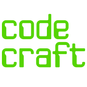
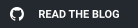
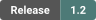
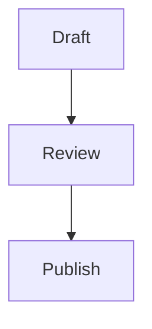
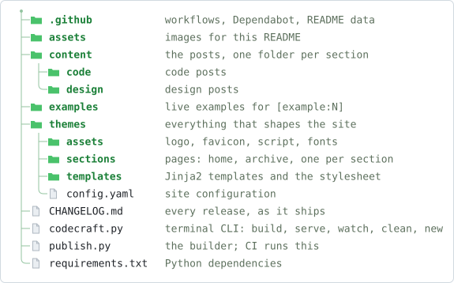

<div align="center">
  
</div>

<p align="center">
<!--[[ badge: id=read-the-blog logo=github message="Read the blog" color=24292F style=for-the-badge link="https://lucianofedericopereira.github.io/codecraft/" ]]-->
<a href="https://lucianofedericopereira.github.io/codecraft/"></a>
<!--/-->
</p>

> A small static site generator in Python and Jinja2. It builds one blog, and it builds it well.

[](https://github.com/lucianofedericopereira/codecraft/actions) <!--[[ badge: id=python logo=python label="Python" message="3.11+" color=4D7A77 style=flat link="requirements.txt" ]]--><a href="requirements.txt"></a><!--/--> <!--[[ badge: id=license label="License" message="MIT" color=4D7A77 style=flat link="LICENSE" ]]--><a href="LICENSE"></a><!--/--> <!--[[ badge: id=changelog label="Release" message="1.2" color=4D7A77 style=flat link="CHANGELOG.md" ]]--><a href="CHANGELOG.md"></a><!--/-->

Codecraft is the engine behind [design﹢code](https://lucianofedericopereira.github.io/codecraft/). I write in Markdown, push to GitHub, and a couple of minutes later the post is live. No Ruby, no Node toolchain, no theme marketplace. Two Python scripts, a folder of templates, and a folder of posts.

Hugo, Jekyll, Eleventy and Pelican are all excellent. They are also general-purpose, and general-purpose means carrying features for somebody else's blog. Codecraft carries only what this one needs: highlighted code, diagrams, live examples, search, a feed, and the plumbing that helps search engines and language models find the writing.

---

## What it does

- **Writes in Markdown.** Each post is a `.md` file with a little YAML at the top. Code blocks are highlighted with Pygments at build time, so readers download colour, not a highlighter.
- **Draws diagrams.** A `mermaid` code block becomes an SVG in the browser, and the library only loads on posts that ask for it.
- **Runs live examples.** `[example:1]` drops a split-pane viewer into a post: HTML, CSS and JavaScript tabs on one side, the running result on the other.
- **Searches without a server.** The build writes the full text of every post into a JSON index, and the browser fetches it the first time someone searches. Press `s` to search from anywhere.
- **Feeds and comments.** An RSS feed for readers who still use one (I do), and Utterances for comments backed by GitHub issues.
- **Gets found.** Real meta descriptions, Open Graph article tags, schema.org `BlogPosting` data, canonical URLs, a sitemap in XML, HTML and Markdown, and an `llms.txt` index. Every post is also published as plain Markdown next to its page.
- **Ships small.** The HTML is minified on the way out.

---

## Getting started

You need Python <!--[[ $release.python ]]-->3.11<!--/--> or later. CI builds with 3.12.

```bash
git clone https://github.com/lucianofedericopereira/codecraft.git
cd codecraft
pip install -r requirements.txt
```

Start a post:

```bash
python codecraft.py new -c code -t "My First Post"
```

That writes `content/code/my-first-post.md` with the frontmatter filled in. Write, then look at it:

```bash
python codecraft.py serve
```

and open http://localhost:8000. When it reads right, commit and push to `main`. GitHub Actions builds the site and publishes it to GitHub Pages.

---

## Writing posts

### Frontmatter

```yaml
---
title: "Your Post Title"          # required
date: 2026-01-15                  # YYYY-MM-DD; see below if left out
description: "One-line summary"   # optional, see below
updated: 2026-02-01               # optional, last significant edit
tags: [sqlite, nim]               # optional, from the tags in the config
comments: true                    # Utterances comments
toc: true                         # table of contents
mermaid: false                    # load Mermaid for diagrams
codepen: false                    # load the CodePen embed script
banner: false                     # banner on section pages
sidebar: true                     # list the page in the sidebar
---
```

Leave `description` out and the first paragraph of the post is used, trimmed to 160 characters. It is worth writing one when your opening line is a hook rather than a summary. The description shows up in search results, link previews, the feed and `llms.txt`.

Leave `date` out and the build warns and uses the date of the file's last commit, or its modification time if it hasn't been committed yet. Not the modification time alone: a fresh checkout in CI gives every file the time of the checkout.

`updated` is for edits that matter. It becomes the post's `lastmod` in the sitemap and `dateModified` in its structured data. Fixing a typo is not an update.

Anything you can set here can also have a default per folder, through `rules` in the config.

### Tags

A post has one section and any number of tags. Sections decide the URL; tags cut across them, so a `code` post and a `design` post can share `typography`.

Tags come from a list in the config, so `js` and `javascript` never drift apart. A post can write a tag in any case: `sqlite` and `SQLite` are the same tag. To put a description on a tag's page, write the tag as `SQLite: { description: "…" }` instead of `- SQLite`. A tag the config doesn't declare is a build warning naming the file, and the post is built without it. A tag shows as a chip under every post that uses it. Once `tag_min_posts` posts use it (3 unless the config says otherwise), it also gets a page at `tags/<tag>/` with its own feed, and the chip links there. Below that, the chip is plain text, so a tag with one or two posts never makes a thin page. To give a tag's page your own title or an introduction, write `themes/sections/tags/<tag>.md` and put `` where the list goes, as with section pages.

Each tagged post ends with related posts, picked at build time: the posts sharing the most tags first, then the newest posts from its own section. A post without tags gets none. `related` in the config tunes it; with fewer than `min` candidates the block is left out, and `max: 0` turns it off.

### Code

Fence it and name the language:

````markdown
```python
def hello():
    print("Hello, design﹢code")
```
````

### Diagrams

Set `mermaid: true`, then:

````markdown

````

To show a Mermaid block *as code* instead of drawing it, wrap it in a `~~~` fence.

### Live examples

Put a standalone HTML file in `examples/`, say `examples/1.html`, with its CSS in `<style id="example-css">` and its JavaScript in `<script id="example-js">`. Then write `[example:1]` on a line of its own in the post. [`examples/README.md`](examples/README.md) has the full template.

---

## Configuration

Everything lives in `themes/config.yaml`.

```yaml
post_limit: 10            # posts on the home page
minify: true              # minify the HTML output

base:
  url: you.github.io
  folder: blog            # leave empty for a user or organization site

meta:
  title: design﹢code
  tagline: CodeCraft Chronicles
  author: Your Name
  repository: https://github.com/you
  license: GPLv2          # the license of your posts, shown under each one
  locale: en

assets:
  images:
    logo: codeCraft.ico
    favicon: codeCraft.ico
  fonts:
    - type: title
      name: Mediaan
      weight: Regular
      extension: woff2

texture:                  # paper texture behind the posts, drawn in the browser; leave out for none
  seed: 42                # same seed, same texture
  ink: "#453E35"          # dark fibres and grain
  light: "#FFFFF8"        # light fibres and grain
  fibres: 320
  fibre_opacity: 0.18
  grain_opacity: 0.35     # also: fibre_size 160, fibre_scale 1120, grain_size 192, grain_alpha 18

links:                    # sidebar links
  GitHub: https://github.com/you

sections:
  - design
  - code
  - projects

tags:                     # shown as written; the URL is the name in lowercase (tags/sqlite/)
  - SQLite
  - Nim
tag_min_posts: 3          # posts a tag needs before it gets a page

related:                  # related posts at the end of each post
  min: 2                  # fewer candidates than this: no block
  max: 5                  # most shown; 0 turns it off
  fallback: section       # fill from the post's own section; none to use shared tags only

rules:                    # frontmatter defaults, by path from the repository root
  - scope:
      path: content
    features:
      toc: true

comments:                 # Utterances
  theme: github-light
  repo: you/comments
  issue: title
  src: https://utteranc.es/client.js

scripts:                  # CDN versions
  mermaid: 12.1.0
```

---

## The command line

`codecraft.py` is for working on the blog from a terminal.

```bash
python codecraft.py build              # build into build/
python codecraft.py serve              # build if needed, serve on :8000
python codecraft.py serve -p 3000      # another port
python codecraft.py watch              # rebuild whenever something changes
python codecraft.py clean              # remove build/ and __pycache__/
python codecraft.py new -c design -t "UI Tips" -s ui-tips -d 2026-01-15
```

`new` takes `--mermaid`, `--codepen`, `--no-comments` and `--no-toc` for the frontmatter, `-e` to open the post in `$EDITOR`, and `-f` to overwrite without asking.

`serve` serves exactly what CI would deploy. It rewrites `<base>` and the site's own URLs on the fly so links resolve on localhost, and it turns the production console silencing off so you can see errors.

`watch` needs `pyinotify` (`pip install pyinotify`). It rebuilds on every change but does not reload the browser for you.

---

## How it is put together

<!-- filetree:start dir="." style="svg" color="green" descriptions=".github/filetree.json" max-depth="2" exclude="content/**/*.md,themes/assets/fonts,themes/assets/*.*,themes/templates/*.*,themes/sections/*.*,examples/*.html,assets/*.*,assets/badges,.github/workflows,.github/*.*,LICENSE,README.md,.nojekyll,.gitignore" svg-output="assets/project-tree.svg" title="Codecraft project structure" -->

<!-- filetree:end -->

Two scripts, one builder.

`publish.py` holds the whole build. It has no terminal dependencies, prints plain progress lines, and is what GitHub Actions runs. `codecraft.py` imports it and adds the things you only want at a keyboard: the progress bar, coloured warnings, the dev server, the watcher and post scaffolding. A local build is byte for byte what CI deploys.

A build does this, in order:

1. Empty `build/`.
2. Read the posts in `content/<section>/` and the pages in `themes/sections/`.
3. Render every post through `codeCraft.html`.
4. Render the pages, expanding their `` listings.
5. Write `feed.xml` and `search.json`.
6. Write `sitemap.xml`, `sitemap/`, `sitemap.md`, `llms.txt`, `llms-full.txt`, and the Markdown version of every post and page.
7. Copy the theme assets and examples, and generate the CSS with the configured fonts.

If a post can't be read, the build says so and carries on without it.

### What the build publishes

| Path | What it is |
|---|---|
| `code/my-post/` | the post |
| `code/my-post.md` | the post's Markdown source |
| `index.md`, `archive.md`, `code.md`… | the home, archive and section pages as Markdown |
| `feed.xml` | RSS feed |
| `tags/`, `tags.md` | every tag in use, with its number of posts |
| `tags/sqlite/`, `tags/sqlite.md`, `tags/sqlite/feed.xml` | a tag's posts by year, as a page, as Markdown and as a feed |
| `search.json` | search index, the full text of every post |
| `sitemap.xml` | sitemap for search engines |
| `sitemap/`, `sitemap.md` | the same sitemap for people, in the site's theme, and as Markdown |
| `llms.txt` | an index of every page and post for language models |
| `llms-full.txt` | every post in one file |

Nothing links to the sitemap pages. `sitemap.xml` lists them, and `llms.txt` links the Markdown one, which is all a crawler needs.

---

## Making it yours

Templates live in `themes/templates/`:

| File | Renders |
|---|---|
| `codeCraft.html` | the page layout, with `head.html`, `aside.html` and `title.html` |
| `posts.html` | latest posts on the home page |
| `category.html` | a section's posts by year |
| `archive.html` | every post by year |
| `tag.html`, `tags.html` | a tag's posts by year, and the list of tags |
| `posts.md`, `category.md`, `archive.md`, `tag.md`, `tags.md` | the same listings for the Markdown pages |
| `codeCraft.css` | the stylesheet, itself a template so fonts come from the config |
| `feed.xml`, `search.json`, `sitemap.xml`, `sitemap.html`, `sitemap.md`, `llms.txt`, `llms-full.txt` | the generated files |

Pages are Markdown files in `themes/sections/`. `home.md` becomes the front page, and every other file becomes a page at its own name. A section without a file there gets a page anyway, listing its posts by year; write the file only when you want your own title or an introduction. A section with no posts yet gets no page at all.

Templates get these filters on top of Jinja2's own: `date_format(format)`, `month_year`, `date_archive`, `date_full`, `year`, `strip_whitespace` and `split(separator)`.

### Adding a section

Add it to `sections` in `themes/config.yaml` and write a post:

```bash
python codecraft.py new -c tutorials -t "My First Tutorial"
```

That's the whole job. The section gets its page, its archive filter, its place in the feed, the sitemap and `llms.txt`, and new years show up in the archive on their own. Nothing in the templates or the stylesheet names a section or a year.

---

## This README

The badges, the project tree and the release numbers above are generated. A workflow runs [sigilbadges](https://github.com/lucianofedericopereira/sigilbadges), [treegen2](https://github.com/lucianofedericopereira/treegen2) and [sigilmd](https://github.com/lucianofedericopereira/sigilmd) on every push to `main` and commits whatever changed. The tree's notes live in `.github/filetree.json` and the numbers in `.github/sigilmd.toml`. Edit those, not the generated blocks.

This is release <!--[[ $release.version ]]-->1.2<!--/-->. The [changelog](CHANGELOG.md) has the rest.

---

## When something goes wrong

**`ModuleNotFoundError`.** Run `pip install -r requirements.txt` again, in the environment you're actually using.

**The live site didn't change.** Check the Actions tab first. In the repository settings, **Pages → Source** has to be **GitHub Actions**. After a green run, the Pages CDN can take a minute or two.

**Port 8000 is taken.** Use `python codecraft.py serve -p 3001`.

**A post is missing.** Read the build output. A post with broken frontmatter is skipped with a warning that names the file.

---

## License

The engine is [MIT](LICENSE). The posts on design﹢code are published under the license set in `themes/config.yaml`.

## Built with

[Python](https://python.org), [Jinja2](https://jinja.palletsprojects.com/), [Python-Markdown](https://python-markdown.github.io/), [Pygments](https://pygments.org/), [PyYAML](https://pyyaml.org/), [python-frontmatter](https://github.com/eyeseast/python-frontmatter), [minify-html](https://github.com/wilsonzlin/minify-html), [Mermaid](https://mermaid.js.org/) and [Utterances](https://utteranc.es/), deployed with [GitHub Actions](https://github.com/features/actions) to [GitHub Pages](https://pages.github.com/).

Written by [Luciano Pereira](https://github.com/lucianofedericopereira).
