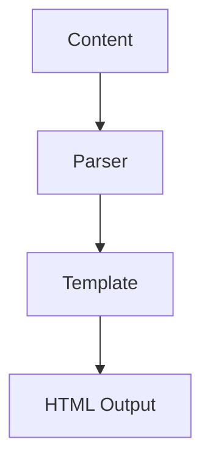

**Codecraft**: A modern, lightweight static site generator powered by Python and Jinja2 — the tool that builds this very blog.

## Writing the Blog Engine

Every blog built on a custom engine contains within it the argument for why the existing options weren't right. Here's the argument for Codecraft.

The existing options — Hugo, Jekyll, Eleventy, Pelican — are excellent. They're also general-purpose, which means they carry features for use cases that aren't yours. Configuration files in formats you have to look up. Theme systems that want you to adopt their conventions. Plugin ecosystems that solve problems you don't have.

Building a static site generator is a finite project. Python and Jinja2 give you everything you need: Markdown parsing, HTML templating, file system operations, a development server. The result is a tool that does exactly what this blog needs and nothing else.

## Architecture

Codecraft's core loop is simple:

1. Read Markdown files from `content/`
2. Parse YAML frontmatter from each file
3. Convert Markdown body to HTML
4. Render the HTML through a Jinja2 template
5. Write the output to `site/`

```python
import yaml
import markdown
from pathlib import Path
from jinja2 import Environment, FileSystemLoader

def build(content_dir: Path, template_dir: Path, output_dir: Path):
    env = Environment(loader=FileSystemLoader(template_dir))
    template = env.get_template("post.html")
    md = markdown.Markdown(extensions=["fenced_code", "tables", "toc"])

    for source in content_dir.rglob("*.md"):
        text = source.read_text()
        frontmatter, body = parse_frontmatter(text)
        html_body = md.convert(body)
        md.reset()

        output_path = output_dir / source.relative_to(content_dir).with_suffix(".html")
        output_path.parent.mkdir(parents=True, exist_ok=True)
        output_path.write_text(
            template.render(content=html_body, **frontmatter)
        )
```

The `md.reset()` call matters — the `markdown` library is stateful between `convert()` calls, and the TOC extension in particular accumulates state that needs to be cleared.

## Frontmatter

Each article is a Markdown file with YAML frontmatter:

```markdown
---
title: "Stop Dockerizing Your Dev Databases"
date: 2026-01-22
comments: true
mermaid: false
---

Article body starts here.
```

The parser splits on the `---` delimiters:

```python
import yaml

def parse_frontmatter(text: str) -> tuple[dict, str]:
    if not text.startswith("---"):
        return {}, text
    _, fm_raw, body = text.split("---", 2)
    return yaml.safe_load(fm_raw), body.strip()
```

Optional frontmatter keys like `mermaid: true` or `codepen: true` tell the template to load the corresponding JavaScript library only on pages that need it. No global library loading for features used by one article.

## Mermaid Diagrams

One of the more useful features is native Mermaid diagram support. When `mermaid: true` appears in the frontmatter, the template loads the Mermaid library and renders any `mermaid` code blocks as SVG diagrams:

~~~markdown

~~~

The Mermaid library handles the rendering client-side — the static HTML contains the diagram source, and Mermaid converts it to SVG in the browser. No server-side SVG rendering, no build-time dependency on headless Chrome.

## Search with Lunr.js

Full-text search in a static site requires pre-building a search index. Codecraft generates a JSON index at build time:

```python
import json

def build_search_index(posts: list[dict]) -> str:
    index = [
        {
            "id":    post["url"],
            "title": post["title"],
            "body":  post["text_content"],  # stripped of HTML
            "date":  post["date"].isoformat(),
        }
        for post in posts
    ]
    return json.dumps(index)
```

The Lunr.js client loads this JSON and builds an in-memory index. Searches run entirely client-side — no server, no API, no round-trip.

## Translation Support

Codecraft supports bilingual content. Articles can have a translated version, linked from the original. The translation metadata lives in frontmatter:

```yaml
---
title: "Jinja2TT2: A Perl Transpiler"
lang: en
translations:
  es: /code/jinja2tt2-transpiler-perl-es.html
---
```

The template renders a language switcher when translations are available. The translated file is a separate Markdown file with its own frontmatter pointing back at the original.

## Development Server

```bash
python codecraft.py --serve
```

Watches `content/` and `templates/` for changes, rebuilds affected files, and serves the result on `localhost:8000` with live reload. The watch uses Python's `watchdog` library; the live reload uses a small WebSocket server that sends a reload signal to connected browsers.

## Deployment

The output is a directory of static HTML, CSS, and JavaScript files. GitHub Pages deployment is one command:

```bash
python codecraft.py --build && ghp-import site/ -p
```

`ghp-import` pushes the `site/` directory contents to the `gh-pages` branch. GitHub Pages serves it automatically.

## Links

- **GitHub**: [lucianofedericopereira/codecraft](https://github.com/lucianofedericopereira/codecraft)
- **Live**: [lucianofedericopereira.github.io/codecraft](https://lucianofedericopereira.github.io/codecraft/)

## License

MIT
